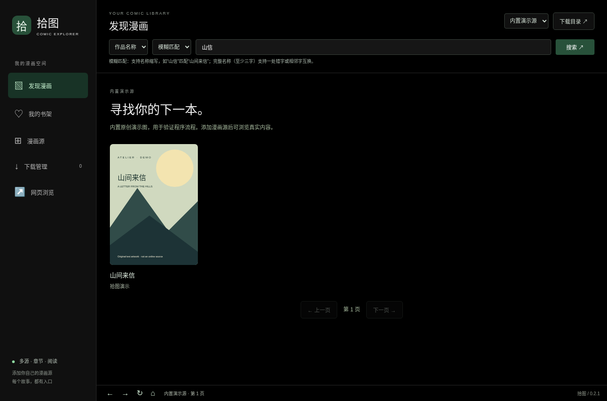
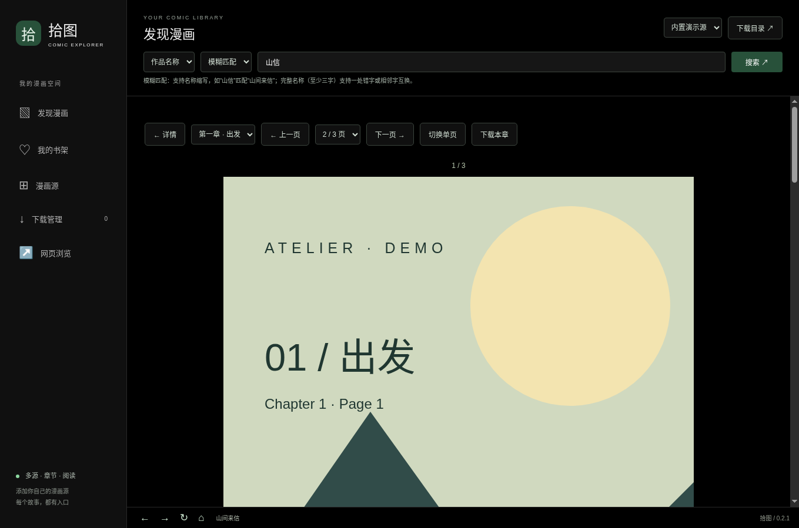

# 拾图 · 多源漫画阅读器

拾图是一款基于 Electron 的桌面漫画阅读器，面向 Windows 开发。通过导入自定义 JSON 漫画源，在统一界面中搜索作品、浏览章节、阅读、收藏和下载漫画。

当前版本：**0.2.2**。采用黑色主题，支持作品名称模糊搜索。

> 当前使用本项目的源格式，不能直接导入 Venera JavaScript 源。没有内置第三方在线漫画站；内置「山间来信」为原创演示图，用于体验和验证完整流程。



<details>
<summary>查看条漫阅读界面</summary>



</details>

## 功能

- **漫画源管理**：从本地 JSON 文件、HTTPS 地址或粘贴 JSON 导入；支持切换与删除。
- **搜索与发现**：作品名称、作者、综合搜索；支持分页与相关度排序。
- **漫画阅读**：作品详情、章节列表、单页与条漫模式、键盘翻页和跨章节切换。
- **书架与进度**：收藏作品，自动保存阅读位置，再次打开后继续阅读。
- **章节下载**：按页码顺序保存整章，显示进度，支持取消和定位文件，同名目录自动编号。
- **网页浏览**：保留独立网页视图、后退/前进/刷新，以及右键单图下载。

## 快速开始

### 从源码运行

需要 **Node.js 22.12 或更新版本**、npm 和 Git。推荐在 Windows 桌面环境使用。

```powershell
git clone https://github.com/Chengbaise/codex-cloud.git
cd codex-cloud
npm ci
npm start
```

首次运行可能从 Electron 官方发行渠道下载运行时，需要可访问对应的 GitHub 发行资源。程序需要图形桌面，不能直接在没有显示服务的服务器终端中显示窗口。

### 使用 Windows 打包版

本仓库跟踪源码、文档和示例；`release/` 构建产物与 `node_modules/` 不上传 Git。Windows 下载入口：[GitHub Releases](https://github.com/Chengbaise/codex-cloud/releases)。版本标签触发构建，构建成功后会出现对应的 Windows ZIP 与 SHA-256 校验文件；如果尚未看到附件，请查看 [Release 工作流](https://github.com/Chengbaise/codex-cloud/actions/workflows/release.yml) 的运行结果，或按下文自行打包。

获得 Windows ZIP 包后，解压全部文件，运行 `拾图.exe`，并保留同目录的运行时文件。当前构建未配置代码签名证书，尚未执行 Windows 实机验证。

### 第一次体验

1. 启动后选择「内置演示源」，点击漫画卡片进入详情。
2. 点击章节阅读，使用左右方向键翻页，或切换条漫模式。
3. 点击「加入书架」收藏；阅读位置会自动保存。
4. 点击「下载本章」，在「下载管理」查看进度或定位文件。
5. 进入「漫画源」，导入 [examples/catalog.json](examples/catalog.json) 体验添加来源。该示例使用 1 像素 PNG 测试页，并非实际漫画内容。

## 作品名称搜索

选择搜索字段和匹配方式，输入关键词后按回车或点击「搜索」。搜索作用于当前漫画源。

| 匹配方式 | 行为 | 示例 |
| --- | --- | --- |
| 包含匹配 | 用名称中的连续片段查找 | `山间` → `山间来信` |
| 模糊匹配 | 支持有序名称缩写；完整查询至少三字时支持一处插入、删除、替换或相邻字互换 | `山信`、`山间来芯` → `山间来信` |
| 精确匹配 | 按完整名称查找 | `山间来信` → `山间来信` |

目录源搜索会忽略大小写、全半角、空格和标点；结果按完整名称、包含、缩写、近似匹配依次排序。作者模式仅搜索作者字段，空查询显示全部作品。

**API 源的搜索字段与匹配语义由源端实现**，客户端将 `mode`、`match` 等参数传给源中配置的接口；不会扫描 API 未返回的全站目录。

## 添加自己的漫画源

支持两种源：

- **目录源 `catalog`**：JSON 中直接包含漫画、章节与有序图片地址，适合静态目录或自建内容。
- **API 源 `api`**：配置浏览、搜索、详情和章节的 HTTPS GET 接口，由服务端返回统一 JSON 数据。

最小目录源结构：

```json
{
  "format": "atelier-source-v1",
  "id": "my-comics",
  "name": "我的漫画源",
  "version": "1.0.0",
  "type": "catalog",
  "comics": [
    {
      "id": "book-1",
      "title": "作品名称",
      "author": "作者名称",
      "chapters": [
        {
          "id": "chapter-1",
          "title": "第一章",
          "pages": ["https://your-domain.example/001.jpg"]
        }
      ]
    }
  ]
}
```

示例中的域名是占位符，需替换为可访问的实际图片地址。完整字段、API 响应、参数和限制请看 **[漫画源格式文档](docs/source-format.md)**。

**普通漫画网站首页不能直接作为结构化漫画源导入。** 网站没有符合本协议的接口时，需要提供站点适配服务，或维护目录 JSON。导入的 JSON 不会作为脚本执行。

## 数据与下载位置

- 漫画源、书架和进度保存在 Electron 系统用户数据目录的 `comic-data/` 中，不写入项目仓库。
- Windows 默认用户数据位置通常为 `%APPDATA%\拾图\comic-data\`；源码运行时可能使用包名目录。
- 图片默认保存到系统「下载」文件夹，可通过「下载目录」按钮更改。
- 章节按「源名称 / 漫画名称 / 章节名称」分目录保存，图片按 `0001`、`0002` 等页码命名，并生成 `chapter.json`。
- 取消或失败后保留已完成的图片；下载任务列表只保留当前会话。

## 开发与验证

```powershell
npm test
npm run check
```

桌面功能测试需要图形显示服务：

```powershell
npm run test:comics
npm run test:desktop
```

| 命令 | 检查内容 |
| --- | --- |
| `npm test` | 源格式、搜索匹配与排序、API 参数、持久化、下载与取消等 18 项自动测试 |
| `npm run check` | 主进程、preload、界面及源服务脚本的语法检查 |
| `npm run test:comics` | 真实 Electron 窗口中的黑色主题、模糊搜索、阅读、书架、源导入和章节下载 |
| `npm run test:desktop` | 网页搜索、面板切换与单图下载回归 |

桌面测试使用独立临时资料目录，以及本地协议提供的 API 和图片样本，不会读取日常使用的书架，也不能替代第三方站点集成测试。上述检查已在 Linux 云端虚拟显示环境通过；Windows 实机和第三方在线源尚未验证。

## 构建 Windows 包

在 Windows 上生成 NSIS 安装程序：

```powershell
npm ci
npm run dist:win
```

生成未签名 Windows ZIP（也可从 Linux 交叉构建）：

```powershell
npm run dist:win:zip
```

产物位于 `release/`。Linux 上构建 NSIS 需要 Wine；生成 ZIP 不要求 Wine。`npm run pack` 仅生成当前平台的应用目录。Linux/macOS 打包命令已保留，但发行包未验证。

## 发布流程

仓库通过 `.github/workflows/release.yml` 发布 Windows x64 ZIP。更新 `package.json` 与锁文件版本、添加 `docs/releases/v版本号.md` 后，推送对应的 `v版本号` 标签即可触发。工作流在 Windows 上安装依赖、运行自动测试和语法检查、构建 ZIP，然后创建 GitHub Release 并上传 ZIP 与 `SHA256SUMS.txt`。也可以在 Actions 页面选择已有标签手动运行。

工作流使用 GitHub 自动提供的仓库令牌，无需额外配置发布密钥。标签必须与包版本一致，已存在的 Release 不会被自动覆盖。

## 当前限制

- 不兼容 Venera JS 源，尚无内置的第三方在线漫画源。
- API 源暂不支持自定义请求头、专门的登录接口、验证码处理或加密脚本。
- 无源自动更新、下载自动重试、断点续传或应用内离线下载库。
- 已下载章节可从文件夹查看，目前不能导入回应用作为本地漫画库。
- 网页内容的颜色和搜索行为由网站自身决定；黑色主题覆盖应用界面。

## 常见问题

**导入提示超时或 AbortError 怎么办？**

确认填写的是本软件格式的 JSON 清单直链，而非网站首页。网址导入最多等待 90 秒，可以取消；超时、网络中止和网页响应会显示不同提示。也可以先下载有效 JSON，然后从文件导入。文件导入只读取本地清单，不能消除后续图片或 API 请求的网络限制。

**为什么添加网站网址后无法浏览漫画？**

漫画源导入需要本项目协议的 JSON 清单。普通网页需适配成目录源或 API 源；「网页浏览」是单独的浏览功能。

**为什么在云端能运行，但看不到窗口？**

Electron 需要桌面显示服务。云端验证使用虚拟显示器；日常使用推荐在 Windows 桌面启动。

**为什么云端无法访问某个源？**

云环境允许列表需要同时包含源服务器和图片服务器域名。软件的漫画源列表与云环境网络配置相互独立，Windows 本机使用本机网络。

**依赖或运行时下载失败怎么办？**

检查 npm/GitHub 发行资源连接、代理及 CA 配置。Node.js 24 可用 `NODE_USE_ENV_PROXY=1` 沿用环境代理；保持 TLS 与下载校验开启。

## 参考

交互方向参考 [Venera](https://github.com/venera-app/venera) 及其[漫画源文档](https://github.com/venera-app/venera/blob/master/doc/comic_source.md)。本项目使用独立实现和源协议，没有集成 Venera 的源运行时。
